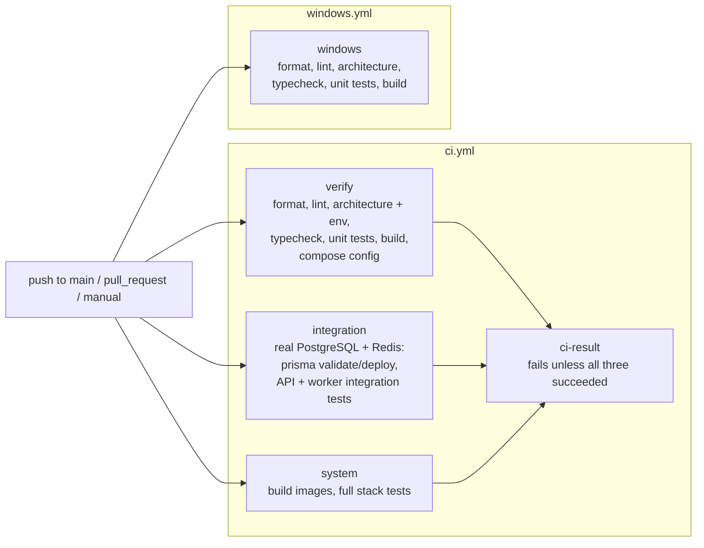

# Continuous integration

Workflows: [`ci.yml`](../../.github/workflows/ci.yml) (Linux, authoritative), [`windows.yml`](../../.github/workflows/windows.yml)
(portability), shared setup in [`.github/actions/setup`](../../.github/actions/setup/action.yml). Decisions:
[ADR-0009](../adr/0009-integration-and-ci.md); the accepted, not yet implemented browser job:
[ADR-0012](../adr/0012-phase-2-4-web-ui-foundations.md).

> **Status of verification.** The workflows were validated statically with `actionlint`, and every command they run was executed
> locally (on Windows and in a clean Linux container, and the Docker stack on a local Docker engine). **They have not been
> executed by GitHub Actions**: the phase branch is not pushed. The first real run is the first proof that the runner-specific parts
> (hosted-runner Docker, the `ubuntu-latest`/`windows-latest` images, action versions, caching) work.

## Jobs

| Job           | Runner         | What it proves                                                                                                                                                                                                                                                                                                                                                                    | Timeout |
| ------------- | -------------- | --------------------------------------------------------------------------------------------------------------------------------------------------------------------------------------------------------------------------------------------------------------------------------------------------------------------------------------------------------------------------------- | ------- |
| `verify`      | ubuntu-latest  | Frozen-lockfile install; Compose files valid (`infra:config`, `stack:config`); Prettier; ESLint with the architecture rules; `check:architecture` (module cycles, worker/web layout, **environment consistency**, their tests); typecheck; all unit tests; build                                                                                                                  | 20 min  |
| `integration` | ubuntu-latest  | PostgreSQL + Redis from the same Compose file developers use (including the `db-roles` provisioning); `db:validate`, `db:deploy` (as the migration role); API integration tests with the **real roles** (database privileges, the audit guard, authentication against real PostgreSQL and Redis) and worker integration tests incl. **real SIGTERM/SIGINT/SIGKILL process tests** | 25 min  |
| `system`      | ubuntu-latest  | Builds the three images and runs the Docker system tests (startup order, role separation, authentication through the web proxy, dependency loss/recovery, restart policy, health, shutdown, persistence, stuck handler under a supervisor)                                                                                                                                        | 45 min  |
| `ci-result`   | ubuntu-latest  | **A single required status.** Fails unless `verify`, `integration` and `system` all report `success`                                                                                                                                                                                                                                                                              | -       |
| `windows`     | windows-latest | The same install and static/unit/build checks on Windows (paths, line endings, shells)                                                                                                                                                                                                                                                                                            | 30 min  |

Triggers: pushes to `main`, every pull request, and manual dispatch. A phase branch therefore gets CI when its pull request is
opened (or when dispatched by hand); there is no separate push trigger for phase branches, to avoid running everything twice.

### Planned: the `browser` job (accepted in ADR-0012, not implemented yet)

The diagram and the table above are what exists today: there is **no** browser job. [ADR-0012](../adr/0012-phase-2-4-web-ui-foundations.md)
accepts real-browser end-to-end tests and delivers them in Phase 2.4 step 7. The decided shape:

- A new **Linux-only job `browser`** in `ci.yml` runs Playwright (`@playwright/test`, **Chromium only**) against a throwaway Compose stack,
  through `pnpm test:browser`. The tests live in `tests/system` as their own runner entry, reusing the system-test stack harness, and are
  separate from the Vitest system tests, which stay in the `system` job.
- Chromium is installed **only in that job** (`playwright install --with-deps chromium`, browser cache keyed by the Playwright version).
  The `system` job is not modified and installs no browser. **`windows.yml` is not touched**: no browser installation or execution on Windows.
- `browser` will be added to the `needs` of `ci-result`, so the single required status still fails unless it succeeded. No
  `continue-on-error`. Traces and screenshots are uploaded on failure only; the same leftover-project cleanup, limited to the
  `agentos-systest-` prefix, runs `if: always()`.
- Settled at implementation (ADR-0012 open questions): the exact Playwright version and compatibility, the Content-Security-Policy
  decision, and whether the job builds its own images or reuses the `system` job's.

## Design points

- **No duplicated verification logic.** Every step calls a root package script or Nx target (`pnpm lint`, `pnpm test:integration`,
  `pnpm test:system`): the commands you run locally. The install is one composite action used by every job.
- **Deterministic installs.** `pnpm install --frozen-lockfile` everywhere; the Docker build does the same. Node 22 and pnpm
  come from `package.json` (`packageManager`), checked against the Dockerfile by `check-env`.
- **Nothing can pass by being skipped.** No `continue-on-error`; `ci-result` rejects `skipped`, `cancelled` and `failure` alike;
  `if: always()` is used only for cleanup. Tests that cannot run on an OS are `skip`ped _visibly_ in the report (the POSIX-only
  signal tests on Windows) and run on Linux, where they are required.
- **Isolation.** Integration tests use Redis logical database 15 with a unique prefix per test and throwaway PostgreSQL
  databases, against the CI instance created for that run. System tests create their own Compose project, volumes, network,
  ports and credentials, and refuse to delete anything outside the `agentos-systest-` prefix. Nothing touches a developer,
  staging or production database.
- **Secrets.** CI generates throwaway credentials with `pnpm setup:env`, which registers them with the runner's masking
  (`::add-mask::`) before anything else can print them. No repository secret is used. Container logs and test output were checked
  for credential values (none).
- **Failure diagnosis.** On failure the integration job prints infrastructure logs; the system job lists containers and volumes.

## Is Linux CI enough? Is a Windows workflow needed?

- **Linux is authoritative** for everything that depends on the OS: POSIX signals (Node on Windows cannot deliver SIGTERM/SIGINT to
  a child), Docker with Linux containers, restart policies, the production runtime. Required checks live here.
- **Windows is a separate, lighter workflow** because developers work on it and the failures it catches (path separators,
  `\r\n`, shell syntax, `localhost` resolution) never appear on Linux. GitHub's Windows runners cannot run Linux containers, so it
  cannot run integration or system tests; it runs what needs no Docker. It is separate so a Windows-only break is labelled as such
  and so it can be made required or advisory independently. _Recommendation:_ require `CI result`; add `Windows portability`
  as required once it has proven stable.
- **Not included (by decision):** macOS, a Node version matrix (one supported major, pinned), browser/E2E tests (none exist yet; the
  Linux-only `browser` job of ADR-0012 is accepted and planned, see above), image publishing, deployment.

## Running the same checks locally

| CI step         | Local command                                                                                                                                                        |
| --------------- | -------------------------------------------------------------------------------------------------------------------------------------------------------------------- |
| verify          | `pnpm setup:env && pnpm infra:config && pnpm stack:config && pnpm format:check && pnpm lint && pnpm check:architecture && pnpm typecheck && pnpm test && pnpm build` |
| integration     | `pnpm infra:up && pnpm db:validate && pnpm db:deploy && pnpm test:integration`                                                                                       |
| system          | `pnpm test:system` (needs Docker; builds images first; `SYSTEST_SKIP_BUILD=1` reuses images only if they were built from this commit)                                |
| workflow syntax | `docker run --rm -v "$PWD:/repo:ro" -w /repo rhysd/actionlint:latest`                                                                                                |
