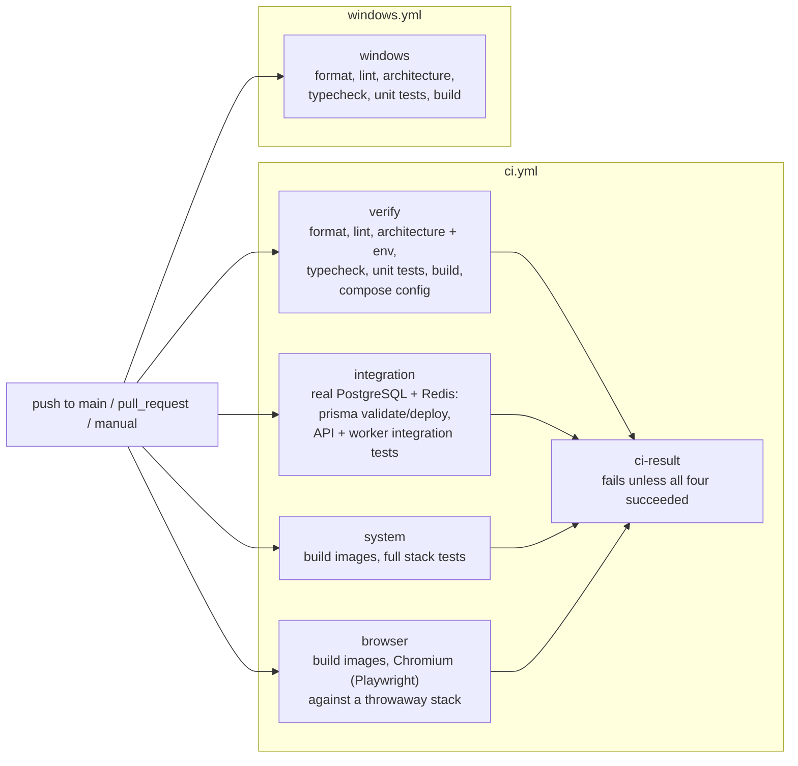

# Continuous integration

Workflows: [`ci.yml`](../../.github/workflows/ci.yml) (Linux, authoritative), [`windows.yml`](../../.github/workflows/windows.yml)
(portability), shared setup in [`.github/actions/setup`](../../.github/actions/setup/action.yml). Decisions:
[ADR-0009](../adr/0009-integration-and-ci.md); the browser job:
[ADR-0012](../adr/0012-phase-2-4-web-ui-foundations.md).

> **Status of verification.** GitHub Actions has run these workflows. On `main` at `686fa9a` (2026-11-18,
> [Linux run 44304104596](https://github.com/ehsanEbr/AgenOS/actions/runs/44304104596)) `verify`, `integration`, `system`, `browser`
> and `ci-result` completed with success, and so did Windows portability
> ([run 44304103963](https://github.com/ehsanEbr/AgenOS/actions/runs/44304103963)). The first hosted `pnpm test` of the web UI
> (`3bb1bef`) failed on Linux `verify` and on Windows. The causes and the fixes are in [Hosted unit tests](#hosted-unit-tests). That
> paragraph records those runs. A later commit needs its own run.

## Jobs

| Job           | Runner         | What it proves                                                                                                                                                                                                                                                                                                                                                                    | Timeout |
| ------------- | -------------- | --------------------------------------------------------------------------------------------------------------------------------------------------------------------------------------------------------------------------------------------------------------------------------------------------------------------------------------------------------------------------------- | ------- |
| `verify`      | ubuntu-latest  | Frozen-lockfile install; Compose files valid (`infra:config`, `stack:config`); Prettier; ESLint with the architecture rules; `check:architecture` (module cycles, worker/web layout, **environment consistency**, their tests); typecheck; all unit tests; build                                                                                                                  | 30 min  |
| `integration` | ubuntu-latest  | PostgreSQL + Redis from the same Compose file developers use (including the `db-roles` provisioning); `db:validate`, `db:deploy` (as the migration role); API integration tests with the **real roles** (database privileges, the audit guard, authentication against real PostgreSQL and Redis) and worker integration tests incl. **real SIGTERM/SIGINT/SIGKILL process tests** | 25 min  |
| `system`      | ubuntu-latest  | Builds the three images and runs the Docker system tests (startup order, role separation, authentication through the web proxy, dependency loss/recovery, restart policy, health, shutdown, persistence, stuck handler under a supervisor)                                                                                                                                        | 45 min  |
| `browser`     | ubuntu-latest  | Builds the three images, boots one throwaway Compose stack and drives **Chromium** (Playwright) against the real web UI: sign-up and sign-in, organizations, projects, members, roles, the session across reloads and tabs, Escape and the other dialog dismissals, English by default and Persian/RTL (see below)                                                                | 45 min  |
| `ci-result`   | ubuntu-latest  | **A single required status.** Fails unless `verify`, `integration`, `system` and `browser` all report `success`                                                                                                                                                                                                                                                                   | -       |
| `windows`     | windows-latest | The same install and static/unit/build checks on Windows (paths, line endings, shells)                                                                                                                                                                                                                                                                                            | 30 min  |

Triggers: pushes to `main`, every pull request, and manual dispatch. A phase branch therefore gets CI when its pull request is
opened (or when dispatched by hand); there is no separate push trigger for phase branches, to avoid running everything twice.

### The `browser` job (ADR-0012 D1)

Real-browser end-to-end tests of the web UI, through `pnpm test:browser`:

- **What it runs.** Playwright (`@playwright/test`, pinned to an exact version in `tests/system/package.json`) with **Chromium only**, in
  `tests/system` as its own runner entry (`playwright.config.ts`, `browser/*.browser.ts`). The Vitest system tests stay as they are, in the
  `system` job; neither runner can pick up the other's files (different suffix and `include`).
- **Linux only, browser only here.** Chromium is installed **only in this job** (`pnpm browser:install` = `playwright install --with-deps
chromium`; the download is cached per Playwright version). The `system` job is unchanged and installs no browser; **`windows.yml` is
  not touched**. The `@playwright/test` package itself installs everywhere with `pnpm install` (it has no install script and downloads no
  browser), so `lint` and `typecheck` cover the browser tests on Windows too, but nothing runs a browser there.
- **Own images.** The job builds its own images for the commit under the test tag, exactly like `system`, and verifies their provenance
  (the open question of ADR-0012 Q3): the two jobs share nothing, at the price of building the images twice.
- **Isolation.** One throwaway Compose project per run (`agentos-systest-<id>`: own volumes, network, ports and generated credentials),
  destroyed at the end; a fresh browser context per test; each test builds its own organization; one worker, no retries. The browser opens
  `http://localhost:<port>` (the API accepts only the configured origin). A test fails on any request to a host other than the stack and on
  any uncaught page error. The same leftover-project cleanup as the `system` job runs `if: always()`.
- **Reports.** Playwright's HTML report, traces and screenshots are uploaded **on failure only**, kept 7 days; they come from a throwaway
  stack with generated credentials.
- **Required.** `browser` is in the `needs` of `ci-result`; no `continue-on-error`.
- **Content-Security-Policy (ADR-0012 Q2).** No policy is introduced in this step. See [frontend.md](frontend.md) section 12 for what the
  built application loads and why a policy needs its own reviewed change.

## Hosted unit tests

`pnpm test` for `apps/web` renders the whole application in jsdom. Limits that passed on a large development machine were too small on a
hosted 4-vCPU runner, where the `verify` job's `pnpm test` step took about 14 minutes (about 5 minutes on the machine the limits were
first chosen on). What is in the tree now:

- **Job timeout.** `verify` in `ci.yml` and `windows` in `windows.yml` are 30 minutes. The test step alone used about 14, so 20 minutes
  is not enough room.
- **Per-test limits.** `apps/web/vite.config.ts` sets `testTimeout` and `hookTimeout` to 30 seconds (Vitest's default is 5).
  `apps/web/src/test/setup.ts` sets Testing Library's `asyncUtilTimeout` to 15 seconds, still under the test timeout, so a real failure
  is the assertion. The heavy router and auth specs set a higher file or tier limit (60 seconds, and up to 180 seconds for the slowest
  tiers). A test that hangs still fails.
- **Reading a CI failure.** Nx replays a task's output through a pipe. The default Vitest reporter prints one line per slow test, and on
  the hosted Linux `verify` job that listing was cut off before the failures and the summary (the reproduction in commit `fec9fc2` puts
  the cut at about 64 KiB). When `CI=true`, the web suite uses the `dot` reporter plus `github-actions`: one character per test, the
  failures in full at the end, and annotations. Without `CI`, the default reporter is unchanged. A local run with `CI=true` shows dots
  on purpose.
- **Counting requests.** The application client keeps query data fresh for 30 seconds (`staleTime` in
  `apps/web/src/app/providers/query-client.ts`). A jsdom test that leaves a page and comes back can take longer than that on a slow
  runner, so a second fetch is correct. A test that counts requests gives its client `staleTime: Infinity`. See
  `project-routes.spec.tsx`, "starts from the first page when the user moves to another project's members". With the default
  `staleTime`, that test received `['0', '0']` where it expected `['0']`.

## Design points

- **No duplicated verification logic.** Every step calls a root package script or Nx target (`pnpm lint`, `pnpm test:integration`,
  `pnpm test:system`): the commands you run locally. The install is one composite action used by every job.
- **Deterministic installs.** `pnpm install --frozen-lockfile` everywhere; the Docker build does the same. Node 22 and pnpm
  come from `package.json` (`packageManager`), checked against the Dockerfile by `check-env`.
- **Nothing can pass by being skipped.** No `continue-on-error`; `ci-result` rejects `skipped`, `cancelled` and `failure` alike;
  `if: always()` is used only for cleanup. Tests that cannot run on an OS are `skip`ped _visibly_ in the report (the POSIX-only
  signal tests on Windows) and run on Linux, where they are required.
- **Isolation.** Integration tests use Redis logical database 15 with a unique prefix per test and throwaway PostgreSQL
  databases, against the CI instance created for that run. System tests create their own Compose project, volumes, network,
  ports and credentials, and refuse to delete anything outside the `agentos-systest-` prefix. Nothing touches a developer,
  staging or production database.
- **Secrets.** CI generates throwaway credentials with `pnpm setup:env`, which registers them with the runner's masking
  (`::add-mask::`) before anything else can print them. No repository secret is used. Container logs and test output were checked
  for credential values (none).
- **Failure diagnosis.** On failure the integration job prints infrastructure logs; the system job lists containers and volumes.

## Is Linux CI enough? Is a Windows workflow needed?

- **Linux is authoritative** for everything that depends on the OS: POSIX signals (Node on Windows cannot deliver SIGTERM/SIGINT to
  a child), Docker with Linux containers, restart policies, the production runtime. Required checks live here.
- **Windows is a separate, lighter workflow** because developers work on it and the failures it catches (path separators,
  `\r\n`, shell syntax, `localhost` resolution) never appear on Linux. GitHub's Windows runners cannot run Linux containers, so it
  cannot run integration or system tests; it runs what needs no Docker. It is separate so a Windows-only break is labelled as such
  and so it can be made required or advisory independently. _Recommendation:_ require `CI result`; add `Windows portability`
  as required once it has proven stable.
- **Not included (by decision):** macOS, a Node version matrix (one supported major, pinned), browsers other than Chromium, browser
  tests on Windows, visual-regression testing, image publishing, deployment.

## Running the same checks locally

| CI step         | Local command                                                                                                                                                        |
| --------------- | -------------------------------------------------------------------------------------------------------------------------------------------------------------------- |
| verify          | `pnpm setup:env && pnpm infra:config && pnpm stack:config && pnpm format:check && pnpm lint && pnpm check:architecture && pnpm typecheck && pnpm test && pnpm build` |
| integration     | `pnpm infra:up && pnpm db:validate && pnpm db:deploy && pnpm test:integration`                                                                                       |
| system          | `pnpm test:system` (needs Docker; builds images first; `SYSTEST_SKIP_BUILD=1` reuses images only if they were built from this commit)                                |
| browser         | `pnpm browser:install` once, then `pnpm test:browser` (needs Docker and Chromium; same image rules and `SYSTEST_SKIP_BUILD=1` as `system`)                           |
| workflow syntax | `docker run --rm -v "$PWD:/repo:ro" -w /repo rhysd/actionlint:latest`                                                                                                |
