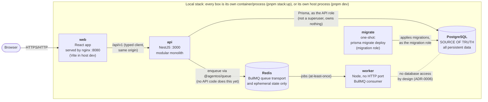
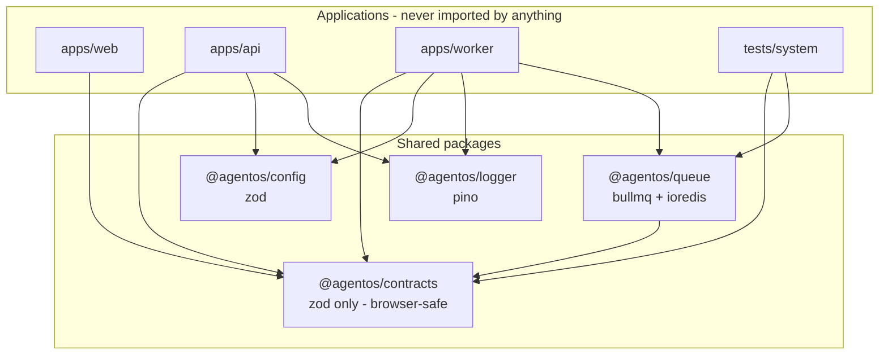

# System overview

How the completed foundations fit together when the whole system runs. Sources of detail: [backend.md](backend.md),
[frontend.md](frontend.md), [workers.md](workers.md), [infrastructure.md](infrastructure.md), [docker-compose.md](docker-compose.md).

## The running system

- **PostgreSQL is the source of truth.** Redis carries queue messages and ephemeral state; nothing that cannot be rebuilt from
  PostgreSQL may live only in Redis. A lost queue loses jobs, not data. (Closing the gap between "committed in PostgreSQL" and
  "enqueued in Redis" is the transactional outbox, a later phase.)
- **Authentication is the default.** Every API route requires a session except health, registration and sign-in; sessions live in
  PostgreSQL (Redis only counts rate-limit attempts, and sign-in fails closed without it). See [backend.md](backend.md#12-authentication-and-the-caller-phase-21).
- **The web app signs people in and opens organizations and projects.** `/sign-in` and `/sign-up` are public. Everything else waits for a
  session. `/projects` only redirects: to the last-used organization when that id is still in the caller's list, otherwise to a chooser or
  to "create your first organization". Project pages live under `/organizations/:organizationId/projects`. The id in the URL is a selector;
  the API still decides access. Walkthrough: [development.md](development.md#open-the-web-app). Behavior: [frontend.md](frontend.md) section 13.
- **Separate processes:** `web`, `api`, `worker` and `migrate` are four independent executables; PostgreSQL and Redis are the two
  infrastructure services. The API and the worker never call each other: they meet only through Redis (and the shared contracts).
- Today the only job is the diagnostic `system.ping`; the API does not enqueue anything yet. The producer side (`QueueProducer`) is
  implemented and tested and is what the system tests use.

## Dependency boundaries (all enforced)

| Boundary                                                                                                                | Enforced by                                                                              |
| ----------------------------------------------------------------------------------------------------------------------- | ---------------------------------------------------------------------------------------- |
| Web imports only `@agentos/contracts`; never backend packages or Prisma/Redis                                           | Nx tags (`scope:web` -> `scope:shared`) + `no-restricted-imports`                        |
| API never imports worker code; worker never imports API code or NestJS                                                  | App-import allowlist + `no-restricted-imports` + Nx tags                                 |
| Worker has no database access                                                                                           | `no-restricted-imports` (Prisma, `pg`); Compose gives it no `DATABASE_URL` (`check-env`) |
| `bullmq` only in `packages/queue` and the worker runtime; `ioredis` only in `packages/queue` and the API's redis module | `no-restricted-imports`                                                                  |
| Redis stays the queue transport; PostgreSQL the source of truth                                                         | Architecture (ADR-0003/0004/0006); the worker cannot reach PostgreSQL                    |
| System tests drive the stack from outside                                                                               | `tests/system` may not import application sources                                        |

`pnpm lint` and `pnpm check:architecture` run all of these. Each rule was verified with a planted violation.

## Process lifecycle at a glance

| Concern          | API                                         | Worker                                                 | Where documented               |
| ---------------- | ------------------------------------------- | ------------------------------------------------------ | ------------------------------ |
| Liveness         | `GET /health` (never checks dependencies)   | process alive                                          | backend.md / docker-compose.md |
| Readiness        | `GET /health/ready` (PostgreSQL + Redis)    | heartbeat file: running **and** Redis connected        | docker-compose.md              |
| Shutdown         | SIGTERM: close, exit 0                      | SIGTERM: drain jobs (grace), exit 0; abandon -> exit 1 | docker-compose.md, workers.md  |
| Restart on crash | `on-failure:5`                              | `on-failure:5`; stuck-handler exit 1 relies on it      | docker-compose.md              |
| Dependency loss  | stays up, `503` on readiness, self-recovers | stays up, not ready, self-recovers (no restart)        | docker-compose.md, workers.md  |
