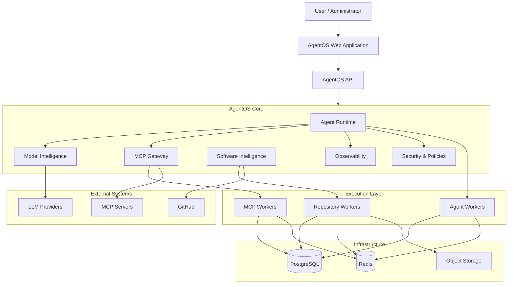
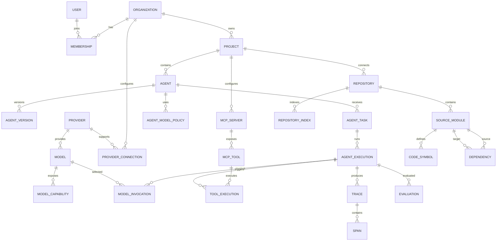
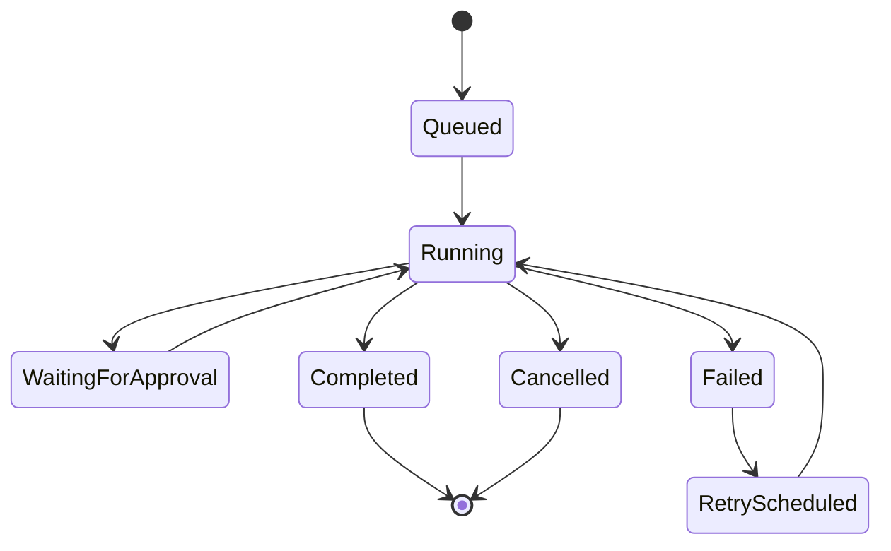
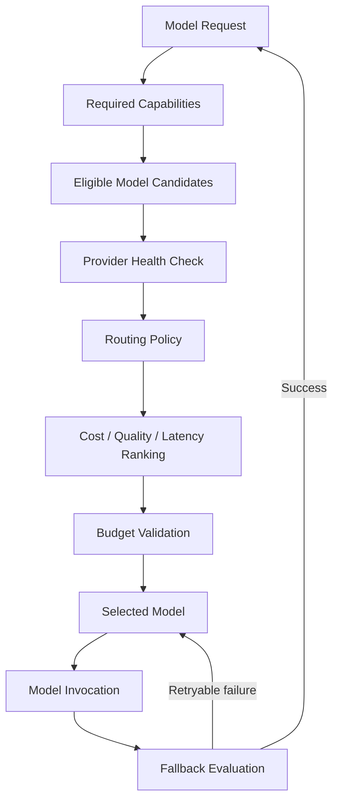

# AgentOS

## Technical Architecture Specification

**Version:** 1.0  
**Status:** Architecture Baseline — Proposed  
**Date:** November 11, 2026  
**Architecture:** Modular Monolith + Independent Workers  
**Deployment:** Hybrid  
**Agent Runtime:** Framework-independent, Adapter-based  
**Product Strategy:** Open Core  
**Primary Language:** TypeScript

---

# 1. Executive Summary

## 1.1 Product Vision

AgentOS یک پلتفرم مستقل برای طراحی، مدیریت، اجرا و نظارت بر سیستم‌های هوش مصنوعی مبتنی بر Agent است.

این پلتفرم سه مسئله اصلی را حل می‌کند:

1. مدیریت و هماهنگی Agentهای هوشمند.
2. دسترسی امن و کنترل‌شده Agentها به ابزارها و سرویس‌های خارجی از طریق MCP.
3. درک ساختار نرم‌افزارها، Repositoryها، معماری، وابستگی‌ها و تأثیر تغییرات کد.

همچنین AgentOS دارای یک زیرسیستم مستقل برای مدیریت مدل‌های زبانی خواهد بود تا Agentها بتوانند از Providerها و مدل‌های مختلف، اعم از تجاری، رایگان، Open-weight و Local استفاده کنند.

## 1.2 Core Principles

- Provider Agnostic
- Framework Independent
- Modular Architecture
- Secure by Design
- Observable Execution
- Cost-aware Intelligence
- Extensible Integration Architecture
- Self-hosted and Cloud Deployment
- Open Core Product Strategy

## 1.3 Architectural Decisions

| Decision         | Selected Architecture         |
| ---------------- | ----------------------------- |
| Deployment       | Hybrid                        |
| Backend          | Node.js + TypeScript + NestJS |
| Frontend         | React + TypeScript + Vite     |
| Database         | PostgreSQL                    |
| Vector Search    | pgvector                      |
| Cache            | Redis                         |
| Queue            | BullMQ                        |
| ORM              | Prisma                        |
| Monorepo         | Nx + pnpm                     |
| Agent Runtime    | Independent Runtime           |
| AI Integration   | Provider Adapters             |
| Tool Integration | MCP Gateway                   |
| Observability    | OpenTelemetry                 |
| Containerization | Docker                        |

---

# 2. System Architecture

## 2.1 High-Level Architecture

AgentOS consists of six core domains and a shared application infrastructure.

### Core Domains

**1. Agent Runtime**

Responsible for:

- Agent lifecycle
- Task execution
- Planning
- Delegation
- Context management
- Handoffs
- Retry and recovery
- Parallel execution
- Human approval integration

**2. Model Intelligence**

Responsible for:

- LLM Provider management
- Model registry
- Model capabilities
- Intelligent routing
- Cost optimization
- Fallback strategies
- Usage tracking
- Model benchmarking

**3. MCP Gateway**

Responsible for:

- MCP Server registration
- Tool discovery
- Tool catalog
- Tool execution
- Permissions
- Authentication
- Rate limiting
- Tool execution audit

**4. Software Intelligence**

Responsible for:

- Repository indexing
- AST extraction
- Dependency graph
- Semantic search
- Architecture analysis
- Change impact analysis
- Technical debt detection
- Architecture history

**5. Observability & Evaluation**

Responsible for:

- Execution traces
- Logs
- Metrics
- Token usage
- Cost tracking
- Evaluation datasets
- Model benchmarking
- Execution analytics

**6. Security & Control Plane**

Responsible for:

- Authentication
- Authorization
- Organization policies
- Project permissions
- Credentials
- Approval workflows
- Audit logs
- Execution constraints

## 2.2 System Context



The diagram represents logical boundaries. It does not require every domain to run as a separate microservice.

## 2.3 Modular Monolith Strategy

The initial backend will be a Modular Monolith.

Reasons:

- Lower infrastructure complexity.
- Easier local development.
- Transactional consistency.
- Faster MVP development.
- Clear domain boundaries.
- Easier future extraction into independent services.

Each domain must expose application interfaces rather than allowing other modules to directly access its internal repositories or database implementation.

Workers are separate processes from the API server, even though they initially share the same codebase and deployment repository.

---

# 3. Architecture Decision Records (ADR)

## ADR-001: Hybrid Deployment

**Status:** Accepted

AgentOS must support both:

- Self-hosted deployment.
- Managed Cloud deployment.

The same application architecture and core feature set should work in both environments.

### Requirements

- Environment-based configuration.
- Docker-based installation.
- External PostgreSQL support.
- External Redis support.
- Configurable object storage.
- Secure secret management.
- Organization-level isolation.
- Deployment-independent domain logic.

Cloud-specific functionality must not leak into the core domain layer.

## ADR-002: Independent Agent Runtime

**Status:** Accepted

AgentOS must not depend on a single Agent framework.

The Runtime will own:

- Agent lifecycle.
- Execution state.
- Task orchestration.
- Context handling.
- Tool invocation coordination.
- Retry policies.
- Execution history.

External frameworks such as LangGraph or OpenAI Agents SDK may be integrated through adapters.

### Runtime abstraction

```ts
interface AgentExecutor {
  execute(input: AgentExecutionInput, context: ExecutionContext): Promise<AgentExecutionResult>;

  cancel(executionId: string): Promise<void>;
}
```

The interface is an architectural starting point. Streaming events, resumability, cancellation, and structured outputs must be represented in the complete runtime contract.

## ADR-003: Provider-independent Model Intelligence

**Status:** Accepted

AgentOS must support multiple LLM providers without making the Agent Runtime aware of provider-specific APIs.

Initial provider categories:

- Direct cloud APIs.
- Aggregators.
- Local inference servers.
- Open-weight models hosted by third parties.

### Provider interface

```ts
interface ModelProviderAdapter {
  listModels(): Promise<ModelDefinition[]>;

  getCapabilities(modelId: string): Promise<ModelCapabilities>;

  invoke(request: ModelRequest): Promise<ModelResponse>;

  stream(request: ModelRequest): AsyncIterable<ModelStreamEvent>;

  healthCheck(): Promise<ProviderHealth>;
}
```

The final contract must also support tool calls, structured output, cancellation, normalized errors, usage metadata, and multimodal requests.

Provider-specific features must be normalized without pretending every model supports every capability.

## ADR-004: PostgreSQL as the Primary Database

**Status:** Accepted

PostgreSQL is the source of truth.

Redis is used for:

- Queue infrastructure.
- Temporary execution state.
- Distributed locks where needed.
- Cache.
- Rate-limit counters.

Redis must not become the authoritative storage for business entities or permanent execution history.

## ADR-005: Monorepo

**Status:** Accepted

Use Nx and pnpm.

Benefits:

- Shared contracts.
- Shared TypeScript types.
- Consistent tooling.
- Dependency graph.
- Build caching.
- Independent application deployment.

## ADR-006: Modular Monolith Before Microservices

**Status:** Accepted

No premature microservice separation.

Domain extraction must be driven by actual operational requirements such as independent scaling, isolation, deployment frequency, or team ownership.

## ADR-007: Worker-based Execution

**Status:** Accepted

Long-running and resource-intensive operations must not execute inside HTTP request handlers.

Use BullMQ for background job processing.

Worker types:

- Agent Worker.
- Repository Worker.
- MCP Execution Worker.
- Scheduler Worker.

## ADR-008: API-first Development

**Status:** Accepted

Frontend and backend must communicate through versioned API contracts.

Use:

- REST API.
- OpenAPI.
- Zod schemas for shared validation where appropriate.
- Generated or contract-validated TypeScript clients.

The frontend must not import backend domain implementation code.

## ADR-009: Open Core Product Strategy

**Status:** Accepted

The core AgentOS functionality will be open source.

Potential commercial extensions may include:

- Enterprise SSO.
- Advanced organization governance.
- Advanced audit and compliance.
- Multi-organization administration.
- Enterprise deployment management.
- Advanced analytics and policy management.

The final license, contribution policy, and exact commercial boundary must be decided before public release.

## ADR-010: Observability by Design

**Status:** Accepted

Every execution must be observable.

The platform must track:

- Task ID.
- Execution ID.
- Agent ID.
- Model invocation.
- Tool invocation.
- Trace ID.
- Latency.
- Token usage.
- Cost.
- Errors.
- Retries.
- Approval events.

---

# 4. Monorepo Architecture

## 4.1 Repository Structure

```text
agentos/
│
├── apps/
│   │
│   ├── web/
│   │   ├── src/
│   │   │   ├── app/
│   │   │   ├── auth/
│   │   │   ├── features/
│   │   │   ├── shared/
│   │   │   └── main.tsx
│   │   └── project.json
│   │
│   ├── api/
│   │   ├── src/
│   │   │   ├── bootstrap/
│   │   │   ├── modules/
│   │   │   ├── common/
│   │   │   └── main.ts
│   │   └── project.json
│   │
│   ├── agent-worker/
│   │   └── src/
│   │
│   ├── repository-worker/
│   │   └── src/
│   │
│   └── scheduler/
│       └── src/
│
├── packages/
│   ├── contracts/
│   ├── sdk/
│   ├── config/
│   ├── logger/
│   ├── observability/
│   └── test-utils/
│
├── database/
│   ├── prisma/
│   │   ├── schema.prisma
│   │   ├── migrations/
│   │   └── seed.ts
│   └── scripts/
│
├── infrastructure/
│   ├── docker/
│   ├── compose/
│   ├── postgres/
│   ├── redis/
│   └── observability/
│
├── docs/
│   ├── architecture/
│   ├── adr/
│   ├── api/
│   ├── security/
│   └── roadmap/
│
├── tools/
├── nx.json
├── pnpm-workspace.yaml
├── package.json
└── README.md
```

## 4.2 Backend Module Structure

Each domain should follow a consistent structure:

```text
modules/model-intelligence/
│
├── domain/
│   ├── entities/
│   ├── value-objects/
│   ├── services/
│   ├── policies/
│   └── ports/
│
├── application/
│   ├── commands/
│   ├── queries/
│   ├── handlers/
│   ├── dto/
│   └── services/
│
├── infrastructure/
│   ├── persistence/
│   ├── providers/
│   └── adapters/
│
├── presentation/
│   ├── controllers/
│   ├── dto/
│   └── mappers/
│
├── model-intelligence.module.ts
└── index.ts
```

Not every module needs every folder. The structure must remain proportional to its actual complexity.

## 4.3 Frontend Feature Structure

```text
apps/web/src/features/
│
├── dashboard/
├── agents/
├── tasks/
├── executions/
├── model-intelligence/
├── mcp-gateway/
├── repositories/
├── architecture-explorer/
├── security/
├── analytics/
└── settings/
```

Each feature should own its UI components, hooks, API integration, state, and tests.

Shared UI components belong in `shared`, not in individual business features.

---

# 5. Domain Boundaries

## 5.1 Identity & Access

Owns:

- Users.
- Organizations.
- Memberships.
- Roles.
- Permissions.
- Sessions.
- Authentication identities.

Other modules must use its authorization interfaces rather than accessing its internal repositories.

## 5.2 Projects

Owns:

- Projects.
- Project members.
- Project settings.
- Project-level integrations.
- Project configuration.

Every project-scoped resource must be associated with an organization and project where applicable.

## 5.3 Agent Runtime

Owns:

- Agent definitions.
- Agent versions.
- Agent configurations.
- Tasks.
- Executions.
- Execution state.
- Agent lifecycle.

It does not own provider connections or MCP server credentials.

## 5.4 Model Intelligence

Owns:

- Providers.
- Provider connections.
- Model registry.
- Model capabilities.
- Routing policies.
- Agent model policies.
- Model invocations.
- Usage and cost records.
- Budgets.

It does not own task orchestration.

## 5.5 MCP Gateway

Owns:

- MCP servers.
- Server connections.
- Tool definitions.
- Tool discovery.
- Tool permissions.
- Tool execution records.
- Credential references.

It does not decide which Agent should execute a business task.

## 5.6 Software Intelligence

Owns:

- Repository connections.
- Repository indexing jobs.
- Commits.
- Source files metadata.
- Modules.
- Symbols.
- Dependencies.
- Architecture rules.
- Analysis results.

Raw source content should not be copied unnecessarily into PostgreSQL. Use controlled object storage and metadata references where appropriate.

## 5.7 Observability

Owns:

- Trace records.
- Span records.
- Evaluation results.
- Metrics.
- Usage analytics.
- Execution event history.

Domain modules publish events; Observability consumes and stores them.

---

# 6. Database Architecture

## 6.1 Database Strategy

Use one PostgreSQL cluster initially.

Logical schemas:

```text
identity
projects
agents
models
mcp
software
observability
security
```

Prisma is the initial ORM.

Database migrations must be version-controlled.

Important rules:

- UUID primary keys.
- UTC timestamps.
- Explicit foreign keys.
- Unique constraints for business identifiers.
- Indexes for frequently filtered fields.
- Organization/project scoping.
- Soft deletion only where business requirements justify it.
- Explicit retention policies for high-volume observability records.

## 6.2 Core Entity Model

### Identity

| Entity         | Important fields                  |
| -------------- | --------------------------------- |
| User           | id, email, display_name, status   |
| Organization   | id, name, slug, status            |
| Membership     | user_id, organization_id, role_id |
| Role           | id, organization_id, name         |
| Permission     | id, key, description              |
| RolePermission | role_id, permission_id            |

### Projects

| Entity             | Important fields                            |
| ------------------ | ------------------------------------------- |
| Project            | id, organization_id, name, slug, settings   |
| ProjectMember      | project_id, user_id, role                   |
| ProjectIntegration | project_id, integration_type, configuration |

### Agents

| Entity         | Important fields                              |
| -------------- | --------------------------------------------- |
| Agent          | id, project_id, name, description, status     |
| AgentVersion   | id, agent_id, version, definition             |
| AgentTask      | id, project_id, agent_id, status, input       |
| AgentExecution | id, task_id, status, started_at, completed_at |
| ExecutionEvent | id, execution_id, event_type, payload         |

### Model Intelligence

| Entity             | Important fields                                     |
| ------------------ | ---------------------------------------------------- |
| Provider           | id, name, provider_type                              |
| ProviderConnection | id, organization_id, provider_id, credential_ref     |
| Model              | id, provider_id, external_model_id, display_name     |
| ModelCapability    | model_id, capability, supported                      |
| AgentModelPolicy   | agent_id, strategy, policy_config                    |
| RoutingPolicy      | id, project_id, strategy, configuration              |
| ModelInvocation    | id, execution_id, model_id, status, usage            |
| UsageRecord        | id, invocation_id, input_tokens, output_tokens, cost |
| Budget             | id, scope_type, scope_id, period, limit_amount       |

### MCP Gateway

| Entity         | Important fields                                      |
| -------------- | ----------------------------------------------------- |
| MCPServer      | id, project_id, name, transport, status               |
| MCPConnection  | id, server_id, connection_config                      |
| MCPTool        | id, server_id, external_name, namespaced_name         |
| ToolPermission | id, tool_id, principal_type, principal_id, permission |
| ToolExecution  | id, execution_id, tool_id, status, duration           |
| Credential     | id, organization_id, encrypted_secret_ref             |

### Software Intelligence

| Entity           | Important fields                                        |
| ---------------- | ------------------------------------------------------- |
| Repository       | id, project_id, provider, external_id                   |
| RepositoryIndex  | id, repository_id, commit_sha, status                   |
| SourceModule     | id, repository_id, path, module_type                    |
| CodeSymbol       | id, module_id, name, symbol_type                        |
| Dependency       | id, source_module_id, target_module_id, dependency_type |
| ArchitectureRule | id, project_id, rule_definition                         |
| AnalysisResult   | id, repository_id, commit_sha, result                   |

### Observability & Security

| Entity          | Important fields                                  |
| --------------- | ------------------------------------------------- |
| Trace           | id, trace_id, project_id, execution_id            |
| Span            | id, trace_id, parent_span_id, operation, duration |
| Evaluation      | id, execution_id, evaluator, score, result        |
| AuditLog        | id, organization_id, actor_id, action, resource   |
| ApprovalRequest | id, execution_id, requested_action, status        |
| Policy          | id, organization_id, scope, definition            |

## 6.3 ERD



This is a conceptual ERD. The physical schema, deletion rules, composite constraints, and tenant isolation strategy must be finalized in the database design before implementation.

## 6.4 Multi-tenancy

The initial data model must support multiple organizations.

Rules:

- Every organization-owned entity has an organization scope.
- Project-owned entities reference a project.
- Access checks validate both organization and project membership.
- Cross-organization access is denied by default.
- Organization-scoped uniqueness must be enforced at database level where appropriate.

PostgreSQL Row Level Security may be introduced as defense in depth. It must not replace application authorization, and pooled database connections must correctly establish and reset tenant context.

## 6.5 Usage and Cost Accounting

Usage must be stored independently from the execution record.

A single execution may contain multiple model invocations.

Store:

- Provider.
- Model.
- Input tokens.
- Output tokens.
- Cached tokens, where available.
- Provider-reported cost.
- Normalized calculated cost.
- Currency.
- Pricing version.
- Timestamp.

Do not overwrite historical cost records when model pricing changes.

---

# 7. API Architecture

## 7.1 API Standards

Base URL:

```text
/api/v1
```

Standards:

- REST.
- JSON.
- OpenAPI.
- Consistent pagination.
- Consistent error format.
- Request validation.
- Authentication and authorization.
- Request correlation ID.
- Idempotency for selected operations.

## 7.2 Standard Response

```ts
interface ApiError {
  code: string;
  message: string;
  details?: unknown;
  correlationId: string;
}
```

Successful resource responses should return their resource representation directly or through a consistent documented envelope.

## 7.3 Identity & Projects

```http
GET    /api/v1/me
GET    /api/v1/organizations
POST   /api/v1/organizations
GET    /api/v1/projects
POST   /api/v1/projects
GET    /api/v1/projects/:projectId
PATCH  /api/v1/projects/:projectId
GET    /api/v1/projects/:projectId/members
```

## 7.4 Model Intelligence

```http
GET    /api/v1/providers
POST   /api/v1/providers/:providerId/connections
POST   /api/v1/provider-connections/:id/test
GET    /api/v1/provider-connections
DELETE /api/v1/provider-connections/:id

GET    /api/v1/models
GET    /api/v1/models/:modelId
GET    /api/v1/models/:modelId/capabilities

GET    /api/v1/routing-policies
POST   /api/v1/routing-policies
PATCH  /api/v1/routing-policies/:id

GET    /api/v1/model-usage
GET    /api/v1/budgets
POST   /api/v1/budgets
```

API keys must never be returned in API responses.

## 7.5 Agent Runtime

```http
GET    /api/v1/agents
POST   /api/v1/agents
GET    /api/v1/agents/:agentId
PATCH  /api/v1/agents/:agentId

POST   /api/v1/agents/:agentId/tasks
GET    /api/v1/tasks/:taskId
GET    /api/v1/tasks/:taskId/executions

POST   /api/v1/executions/:executionId/cancel
GET    /api/v1/executions/:executionId
GET    /api/v1/executions/:executionId/events
```

## 7.6 MCP Gateway

```http
GET    /api/v1/mcp/servers
POST   /api/v1/mcp/servers
POST   /api/v1/mcp/servers/:id/connect
POST   /api/v1/mcp/servers/:id/disconnect
GET    /api/v1/mcp/servers/:id/tools
POST   /api/v1/mcp/tools/:toolId/test
GET    /api/v1/mcp/executions
```

## 7.7 Software Intelligence

```http
GET    /api/v1/repositories
POST   /api/v1/repositories
POST   /api/v1/repositories/:id/index
GET    /api/v1/repositories/:id/indexes
GET    /api/v1/repositories/:id/modules
GET    /api/v1/repositories/:id/dependencies
POST   /api/v1/repositories/:id/analyze
GET    /api/v1/repositories/:id/analysis
```

## 7.8 Real-time Events

Use Server-Sent Events initially for execution progress.

```http
GET /api/v1/executions/:executionId/events/stream
```

Example event types:

```ts
type ExecutionEvent =
  | { type: 'execution.started'; executionId: string }
  | { type: 'agent.started'; agentId: string }
  | { type: 'model.invocation.started'; modelId: string }
  | { type: 'tool.invocation.started'; toolId: string }
  | { type: 'approval.required'; approvalId: string }
  | { type: 'execution.completed'; executionId: string }
  | { type: 'execution.failed'; code: string };
```

Persist important execution events. SSE is a delivery mechanism, not the event store.

---

# 8. Agent Runtime Design

## 8.1 Runtime Responsibilities

The Runtime owns the execution lifecycle and delegates external operations to Model Intelligence and MCP Gateway.

It must not directly instantiate provider-specific SDKs or implement MCP transport details.

## 8.2 Execution Lifecycle



Terminal and retry transitions must be validated by the Runtime state machine.

## 8.3 Execution Context

Each execution receives a controlled context:

```ts
interface ExecutionContext {
  executionId: string;
  taskId: string;
  agentId: string;
  projectId: string;
  organizationId: string;
  traceId: string;
  cancellationSignal: AbortSignal;
}
```

The context must not expose unrestricted database access, credentials, or arbitrary infrastructure handles.

## 8.4 Execution Guarantees

- At-least-once job delivery may occur.
- Job handlers must be idempotent.
- Duplicate execution must be prevented through execution state and idempotency controls.
- Cancellation must propagate to model and tool operations where supported.
- Retry must distinguish transient from permanent failures.
- Execution history must survive worker restarts.

Exactly-once distributed execution is not assumed.

---

# 9. Model Intelligence Design

## 9.1 Routing Pipeline



## 9.2 Routing Strategies

- Cost Optimized.
- Quality First.
- Balanced.
- Auto / Adaptive.
- Manual.

The Router must filter models by required capabilities before ranking candidates.

## 9.3 Budget Controls

Support:

- Organization budgets.
- Project budgets.
- Agent budgets.
- Execution budgets.
- Daily and monthly limits.

Budget actions:

- Warn.
- Downgrade.
- Require approval.
- Reject new invocation.

Cost estimation must be explicit about pricing uncertainty and provider-reported usage.

---

# 10. MCP Gateway Design

## 10.1 Transport Support

Initial transport targets:

- stdio for local MCP servers.
- Streamable HTTP for remote MCP servers.

Transport support must be encapsulated behind adapters.

## 10.2 Tool Execution Flow

1. Agent requests a tool.
2. Runtime validates that the tool is available to the Agent.
3. MCP Gateway validates project and organization permissions.
4. Input is validated against the tool schema.
5. Sensitive or high-risk operations may require approval.
6. Tool execution occurs in the controlled execution environment.
7. Result is normalized.
8. Execution metadata and audit events are recorded.

## 10.3 Security Requirements

- No unrestricted Shell access.
- No arbitrary filesystem access.
- No unvalidated URL fetching.
- No unrestricted internal network access.
- Tool allowlists.
- Server authentication.
- Per-tool permissions.
- Input/output size limits.
- Timeouts.
- Rate limiting.
- Credential isolation.

MCP Server configuration is untrusted input and must be treated accordingly.

---

# 11. Worker Architecture

## 11.1 Worker Processes

| Worker            | Responsibility                     |
| ----------------- | ---------------------------------- |
| Agent Worker      | Agent execution                    |
| Repository Worker | Repository indexing and analysis   |
| MCP Worker        | Controlled tool execution          |
| Scheduler         | Scheduled jobs and recurring tasks |

Workers share application contracts but do not share mutable in-memory execution state.

## 11.2 Queue Design

Initial queues:

```text
agent-executions
repository-indexing
repository-analysis
mcp-executions
scheduled-jobs
```

Each queue needs:

- Retry policy.
- Backoff.
- Timeout.
- Concurrency limit.
- Dead-letter handling.
- Job correlation IDs.

## 11.3 Job Example

```ts
interface AgentExecutionJob {
  executionId: string;
  taskId: string;
  agentId: string;
  projectId: string;
  organizationId: string;
  requestedBy: string;
}
```

Do not place provider credentials or full sensitive execution context inside queue payloads.

## 11.4 Outbox Pattern

Use a transactional outbox when publishing important domain events.

The database transaction writes both the business state change and an outbox record. A publisher delivers events asynchronously.

This prevents the common failure where a database transaction succeeds but event publication is lost.

---

# 12. Security Architecture

Security is a foundational requirement, not a future enhancement.

## 12.1 Authentication

Recommended design:

- OIDC-compatible authentication architecture.
- Support for an external Identity Provider.
- Local authentication for initial self-hosted development if required.
- Short-lived access tokens.
- Secure refresh/session handling.

Do not implement an unnecessary custom identity protocol.

## 12.2 Authorization

Use RBAC initially.

Authorization must consider:

- Organization.
- Project.
- User.
- Role.
- Agent.
- Tool.
- Resource.

Add policy-based authorization for more advanced execution rules.

## 12.3 Secrets Management

- Encrypt credentials at rest.
- Use a dedicated encryption key.
- Keep encryption keys outside the database.
- Never return secrets through API responses.
- Never log credentials.
- Support credential rotation.
- Restrict secret access to authorized workers.

For local development, use environment variables or a development secret store. Production deployments should support a dedicated secret manager.

## 12.4 Repository Security

Repository analysis must run in a sandbox.

Controls:

- No privileged container.
- Read-only repository mount by default.
- CPU and memory limits.
- Execution time limits.
- Network disabled by default.
- Explicitly allowlisted network access when needed.
- No host filesystem access.
- No arbitrary process execution.

## 12.5 LLM Security

- Treat repository contents as untrusted data.
- Treat tool output as untrusted data.
- Defend against prompt injection.
- Separate instructions from retrieved content.
- Never expose system credentials in model context.
- Require approval for sensitive actions.
- Validate structured model outputs.

## 12.6 Audit

Audit events should include:

- Actor.
- Organization.
- Project.
- Action.
- Resource.
- Timestamp.
- Correlation ID.
- Result.

Audit records should be append-only from the application's perspective.

---

# 13. Observability Architecture

Use OpenTelemetry as the instrumentation foundation.

## Trace hierarchy

```text
Task
 └── Agent Execution
      ├── Planning
      ├── Model Invocation
      │    └── Provider Request
      ├── Tool Invocation
      │    └── MCP Server Request
      └── Result Generation
```

Track:

- Duration.
- Status.
- Model.
- Provider.
- Token usage.
- Cost.
- Tool calls.
- Retry count.
- Errors.
- Approval events.

Avoid logging full prompts and sensitive outputs by default. Define configurable retention and redaction policies.

---

# 14. Frontend Architecture

## 14.1 Application Structure

React + TypeScript + Vite.

Recommended libraries:

- React Router.
- Ant Design.
- TanStack Query.
- Zustand.
- React Flow.
- Monaco Editor.
- ECharts.
- Zod.

## 14.2 Primary Navigation

```text
Overview
│
├── Projects
│
├── Agents
│   ├── Agent Registry
│   ├── Agent Builder
│   └── Tasks
│
├── Orchestration
│   └── Workflow Studio
│
├── Model Intelligence
│   ├── Overview
│   ├── Providers
│   ├── Model Registry
│   ├── Routing Policies
│   ├── Agent Model Policies
│   ├── Benchmarks
│   └── Cost & Budgets
│
├── MCP Gateway
│   ├── Servers
│   ├── Tools
│   └── Executions
│
├── Software Intelligence
│   ├── Repositories
│   ├── Architecture Explorer
│   ├── Dependency Graph
│   └── Change Impact
│
├── Observability
│   ├── Execution Traces
│   ├── Logs
│   └── Evaluations
│
├── Security
│   ├── Policies
│   ├── Approvals
│   └── Audit Logs
│
└── Settings
```

## 14.3 Important UI Principles

- Enterprise-grade interface.
- Consistent design system.
- Responsive layouts.
- Clear execution status.
- Live execution visualization.
- Strong filtering and search.
- Accessible forms.
- Explicit loading and error states.

Avoid implementing all screens before the underlying API contracts are stable.

---

# 15. Testing Strategy

## Unit Tests

Test:

- Domain services.
- Routing decisions.
- Authorization policies.
- Execution state transitions.
- Cost calculations.
- Retry decisions.

## Integration Tests

Test:

- PostgreSQL repositories.
- Redis queues.
- Provider adapters.
- MCP transport adapters.
- Outbox publishing.

## Contract Tests

Verify:

- Provider adapter compatibility.
- Tool schemas.
- API request and response contracts.
- Frontend/backend compatibility.

## E2E Tests

Initial scenarios:

1. Create organization.
2. Create project.
3. Connect an LLM provider.
4. Validate provider connection.
5. Create an Agent.
6. Submit a Task.
7. Execute the Task.
8. Inspect the execution trace.
9. Verify token usage and cost.

External APIs should be mocked in CI unless a controlled integration test explicitly requires real credentials.

---

# 16. Phase 0 — Architecture & Specification

**Objective:** Prepare the engineering foundation before substantial implementation.

## Deliverables

### Documentation

- [ ] System Architecture.
- [ ] Architecture Decision Records.
- [ ] Domain Boundaries.
- [ ] Database Design.
- [ ] API Standards.
- [ ] Security Threat Model.
- [ ] Deployment Architecture.
- [ ] Coding Standards.
- [ ] Testing Strategy.

### Technical Decisions

- [ ] Confirm NestJS.
- [ ] Confirm Nx + pnpm.
- [ ] Confirm Prisma.
- [ ] Confirm PostgreSQL and Redis.
- [ ] Confirm API versioning.
- [ ] Confirm authentication strategy.
- [ ] Confirm initial provider adapter.
- [ ] Confirm Worker deployment approach.

### Architecture Validation

- [ ] Validate module dependency rules.
- [ ] Define domain ownership.
- [ ] Define shared package boundaries.
- [ ] Define error handling.
- [ ] Define logging and tracing.
- [ ] Define configuration management.

### Definition of Done

Phase 0 is complete when:

1. All critical architecture decisions are documented.
2. The first database ERD is reviewed.
3. API contracts for Phase 1 are documented.
4. Domain dependency rules are agreed.
5. The development environment can be specified reproducibly.
6. No unresolved architectural decision blocks Phase 1.

---

# 17. Phase 1 — Project Foundation

**Objective:** Build a production-minded technical foundation without prematurely implementing all AgentOS features.

## 17.1 Monorepo Setup

- [ ] Initialize pnpm workspace.
- [ ] Initialize Nx.
- [ ] Create React application.
- [ ] Create NestJS application.
- [ ] Create shared contracts package.
- [ ] Configure TypeScript.
- [ ] Configure ESLint.
- [ ] Configure Prettier.
- [ ] Configure dependency boundary rules.

## 17.2 Infrastructure

- [ ] PostgreSQL Docker service.
- [ ] Redis Docker service.
- [ ] Database migrations.
- [ ] Development environment variables.
- [ ] Health checks.
- [ ] Persistent development volumes.
- [ ] Docker Compose.

## 17.3 Backend Foundation

- [ ] NestJS application bootstrap.
- [ ] Global validation.
- [ ] Standard error handling.
- [ ] Request correlation IDs.
- [ ] Structured logging.
- [ ] Configuration validation.
- [ ] Database module.
- [ ] Redis module.
- [ ] Health endpoints.
- [ ] OpenAPI generation.

## 17.4 Frontend Foundation

- [ ] React application bootstrap.
- [ ] Application routing.
- [ ] Base layout.
- [ ] Design system.
- [ ] API client.
- [ ] TanStack Query.
- [ ] Zustand.
- [ ] Authentication boundary.
- [ ] Error and loading states.

## 17.5 Background Processing Foundation

- [ ] BullMQ configuration.
- [ ] Worker bootstrap.
- [ ] Queue registration.
- [ ] Job lifecycle.
- [ ] Retry configuration.
- [ ] Graceful shutdown.
- [ ] Basic job observability.

## 17.6 Testing & CI

- [ ] Unit testing.
- [ ] Integration testing.
- [ ] Frontend component testing.
- [ ] Build verification.
- [ ] Lint verification.
- [ ] Type checking.
- [ ] GitHub Actions pipeline.

## 17.7 Phase 1 Definition of Done

Phase 1 is complete when:

1. The entire project starts with documented commands.
2. PostgreSQL and Redis are healthy.
3. Prisma migrations execute successfully.
4. Frontend communicates with Backend.
5. OpenAPI documentation is available.
6. At least one background job can be submitted and processed.
7. Health checks work.
8. CI passes.
9. Tests pass.
10. The system shuts down gracefully.

No production LLM integration is required to complete Phase 1.

---

# 18. Phase 2 and Beyond

The following phases are the planned implementation sequence.

| Phase | Deliverable                                  |
| ----- | -------------------------------------------- |
| 2     | Identity, Organizations and Projects         |
| 3     | Model Intelligence                           |
| 4     | Agent Runtime                                |
| 5     | MCP Gateway                                  |
| 6     | Software Intelligence                        |
| 7     | Multi-Agent Orchestration                    |
| 8     | Advanced Intelligence and Evaluation         |
| 9     | Production Hardening and Open Source Release |

The order may be adjusted when integration dependencies justify it, but the domain boundaries must remain intact.

---

# 19. Initial MVP Acceptance Scenario

The first meaningful end-to-end product demonstration:

**Scenario: Execute an AI Agent using a user-selected model.**

1. User creates an organization.
2. User creates a project.
3. User connects an LLM Provider.
4. AgentOS discovers or registers available models.
5. User selects a model or Auto routing policy.
6. User creates an Agent.
7. User submits a Task.
8. Agent Runtime creates an execution.
9. Model Intelligence selects an eligible model.
10. Worker performs the execution.
11. Observability records the execution.
12. User views the result, trace, token usage and cost.

### Expected Result

The user can observe the complete lifecycle of an Agent execution without depending on a specific LLM provider or Agent framework.

This is the first end-to-end capability that demonstrates the core value of AgentOS.

---

# 20. Engineering Rules for AI-Assisted Development

Claude Code and other coding agents may be used to implement this architecture, but they must follow these rules:

1. Read the relevant architecture documents before modifying code.
2. Never redesign core architecture without an explicit ADR.
3. Never bypass module boundaries.
4. Never introduce a new dependency without explaining why.
5. Never create unnecessary abstractions.
6. Never silently remove existing functionality.
7. Write tests alongside implementation.
8. Run lint, typecheck, tests and build before completing a task.
9. Keep changes scoped to the assigned phase.
10. Update documentation when architecture or contracts change.

Every implementation task must include:

- Context.
- Objective.
- Scope.
- Out of scope.
- Acceptance criteria.
- Required tests.
- Expected deliverables.

AI-generated code is not considered complete until it passes the project's verification process.

---

# 21. Final Architecture Baseline

The initial AgentOS architecture is defined as:

**Frontend:** React + TypeScript + Vite

**Backend:** Node.js + TypeScript + NestJS

**Architecture:** Modular Monolith + Independent Workers

**Database:** PostgreSQL

**Vector Search:** pgvector

**Queue:** BullMQ + Redis

**ORM:** Prisma

**Monorepo:** Nx + pnpm

**Agent Runtime:** Independent, Adapter-based

**LLM Integration:** Model Provider Adapters

**Tool Integration:** MCP Gateway

**Observability:** OpenTelemetry

**Deployment:** Hybrid

**Product Strategy:** Open Core

**Development Method:** Architecture-first, incremental implementation, test-driven verification.

The most important architectural rule is:

**AgentOS owns the orchestration, intelligence, governance and execution lifecycle. External providers and frameworks are replaceable infrastructure, not the foundation of the product.**

---

**Document Status:** Version 1.0 — Proposed Architecture Baseline

**Next Milestone:** Phase 0 validation and Phase 1 implementation.

This specification is the baseline reference for subsequent engineering tasks. Any significant deviation should be recorded through an Architecture Decision Record (ADR).
