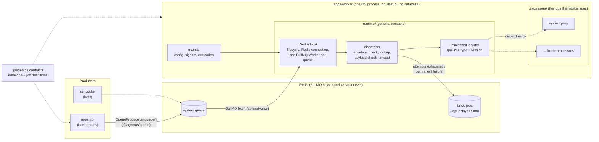
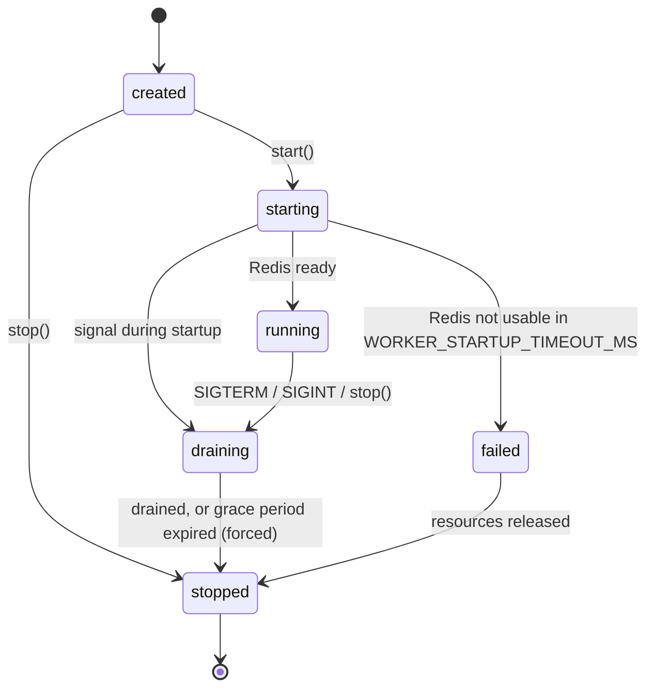

# Workers

Scope: the worker runtime, the queue and job contract, lifecycle, retry and failure semantics, and how to run and operate a
worker locally. Decisions and their trade-offs: [ADR-0006](../adr/0006-worker-runtime.md),
[ADR-0007](../adr/0007-job-contract-and-delivery-semantics.md), [ADR-0008](../adr/0008-shared-backend-packages.md).

> **Implemented in this phase:** the runtime, one queue (`system`), one diagnostic job (`system.ping`), the job envelope, retries,
> failure classification, graceful shutdown, Redis outage recovery, configuration, logging, and tests.
> **Not implemented (later phases):** any domain processor (agent runtime, repository scanning, MCP, model calls), the API
> enqueuing jobs, an outbox, scheduling, a health endpoint for the worker, metrics/tracing export. See [Limitations](#limitations-and-known-gaps).

## Architecture



Solid arrows are implemented; dashed arrows and the API/scheduler producers are the intended future wiring. The producer side
(`QueueProducer` in `@agentos/queue`) is implemented and tested, but nothing in the API calls it yet.

### Process and package layout

```text
apps/worker/src
├─ main.ts            process entry: load config, create host, signal handlers, exit codes
├─ app.ts             composition: config + registry -> WorkerHost
├─ config.ts          worker environment (validated at startup)
├─ runtime/           the worker host. Generic: knows no job. No NestJS, no database.
│   ├─ host.ts        WorkerHost: lifecycle, Redis connection, BullMQ workers, graceful shutdown
│   ├─ dispatch.ts    one delivered job -> validate -> find processor -> run with timeout -> classified result
│   ├─ registry.ts    ProcessorRegistry
│   ├─ processor.ts   the processor contract (read its header comment), JobContext, PermanentJobError
│   ├─ lifecycle.ts   state machine
│   └─ index.ts       the runtime's public API
└─ processors/        concrete processors; registered in index.ts. system.ping only, for now.

packages/contracts    job envelope, queue names, job definitions (zod only)
packages/queue        BullMQ/ioredis wrappers: createRedisConnection, QueueProducer, retry policy, queue definitions
packages/config       parseConfig + shared env schemas + redactUrl
packages/logger       pino options + redaction paths shared by the API and the worker
```

**One host, many workers.** A future agent worker or repository worker is _not_ another runtime: it is the same
`WorkerHost` with a different `WORKER_QUEUES` and a different registry. While only one worker app exists the host lives in
`apps/worker/src/runtime`. The day a second worker app needs it, move that folder to `packages/worker-runtime` (the boundary is
already enforced: `runtime/` imports nothing from `processors/`, `config`, `app` or `main`). Do not move it earlier.

### Boundaries (enforced)

| Rule                                                                                                                                | Enforced by                                                                                              |
| ----------------------------------------------------------------------------------------------------------------------------------- | -------------------------------------------------------------------------------------------------------- |
| The worker does not import `apps/api` (or `apps/web`); the API and web do not import the worker                                     | App-import allowlist + `@nx/enforce-module-boundaries` (tags) + `no-restricted-imports`                  |
| No NestJS, Express, Prisma or database driver in the worker                                                                         | `no-restricted-imports` on `apps/worker/**` (tests included)                                             |
| `bullmq` only in `apps/worker/src/runtime` and `packages/queue`; `ioredis` only in `packages/queue` (and the API's `modules/redis`) | `no-restricted-imports` per folder; the API may not import `bullmq` at all                               |
| `runtime/` must not import `processors/`, `config`, `app`, `main`; processors use the runtime only through `runtime/index.ts`       | `no-restricted-imports` + `tools/check-module-boundaries.mjs apps/worker/src` (cycles, internal imports) |
| `packages/config`, `logger` are leaves; `packages/queue` has no framework                                                           | `no-restricted-imports` per package                                                                      |
| `apps/web` cannot import `config`/`logger`/`queue`                                                                                  | Nx tags (`scope:web` may depend on `scope:shared` only)                                                  |

The worker has **no database access** by design. If a future processor needs PostgreSQL, that is an architectural decision:
write an ADR first (shared Prisma package? an API call? an outbox?). Do not add Prisma to the worker quietly.

## Queue and job contract

Defined in `@agentos/contracts` (`jobs.ts`), so producers and workers cannot drift apart.

```ts
// What every job carries in Redis (the BullMQ job's `data`)
{
  type: 'system.ping',            // '<area>.<action>', lower-case; selects the processor
  version: 1,                     // integer; bumped for breaking payload changes
  correlationId: 'req-abc-123',   // same charset as the API's x-correlation-id header; generated if the producer has none
  createdAt: '2026-01-01T00:00:00.000Z',
  payload: { ... }                // validated by the processor's own schema
}
```

- **Job id, attempt count, queue name and timestamps come from BullMQ**, not from the envelope.
- **Unknown extra envelope keys are ignored**, so a newer producer can add fields without breaking an older worker.
- **A job is defined once**: `defineJob({ queue, type, version, payload })` in contracts. The producer calls
  `QueueProducer.enqueue(job, payload, options)`, which validates the payload against that schema before anything reaches
  Redis. The worker's processor is `defineProcessor(job, handler)` and receives the already-validated, typed payload.
- **Queues** are named in `QUEUE_NAMES` (`system` today). A worker consumes the queues listed in `WORKER_QUEUES`, and refuses to
  start if a listed queue has no processor.
- **Versioning.** A processor is registered for an exact `(queue, type, version)`. During a rolling deploy a worker that does not
  know a version fails that job as `unsupported_version` (permanent, kept in the failed set, retryable by an operator after the
  deploy). Keep old versions registered until their jobs have drained.
- **Idempotent enqueue (optional).** `enqueue(..., { jobId })` with a deterministic id (e.g. `execution-<uuid>`) makes adding the
  same job twice a no-op while the first still exists. This de-duplicates _producers_; it does not replace idempotent processors.

## Delivery semantics: at-least-once

**A job may be delivered to a processor more than once. There is no exactly-once guarantee and none is claimed.**
Redelivery happens when: a worker crashes or is killed mid-job; shutdown outlives the grace period; a handler outlives its
lock/timeout; a worker loses Redis while running a job and the lock expires; an operator retries a job.

The contract for processor authors (the same text is the header of `runtime/processor.ts`):

1. **Be idempotent.** Running a job twice must have the same effect as once. Derive keys from the job (`ctx.jobId`, or a business
   id in the payload), use "insert if absent" / upserts / state checks, and pass idempotency keys to external systems.
2. **Honor `ctx.signal`.** It aborts on timeout and on forced shutdown. Pass it to I/O and stop work promptly. A handler that
   ignores it is still abandoned (its slot is freed and the attempt counts as failed) but may keep running in the background.
3. **Throw `PermanentJobError`** when retrying cannot help (the entity does not exist, the request is invalid). Any other
   thrown error is treated as transient and retried within the attempt budget.
4. **Do not log payloads or secrets.** Use `ctx.logger`; it already carries queue, job id, type, correlation id and attempt.

The runtime provides the delivery half of the contract (a job is acknowledged only after the handler returns; an unfinished job
is never acknowledged). It deliberately provides **no generic database idempotency framework**: what "the same effect" means is
specific to each processor.

## Retry and failure semantics

### Failure classes

| Class       | Reasons                                                                                                 | Retried?                                                  |
| ----------- | ------------------------------------------------------------------------------------------------------- | --------------------------------------------------------- |
| `permanent` | `invalid_envelope`, `unknown_type`, `unsupported_version`, `invalid_payload`, `handler_permanent_error` | **No**: failed immediately, kept for inspection           |
| `transient` | `handler_error` (any other thrown error)                                                                | Yes, until attempts are exhausted                         |
| `timeout`   | `timeout` (no result within `WORKER_JOB_TIMEOUT_MS`)                                                    | Yes, until attempts are exhausted                         |
| `aborted`   | `shutdown` (forced shutdown interrupted the handler)                                                    | n/a: not acknowledged; redelivered after the lock expires |

Malformed input can never crash the worker or loop: every failure above is a rejected promise that BullMQ records as a failed
attempt. Permanent failures are converted to BullMQ's `UnrecoverableError`, which skips the remaining attempts.

### Retry policy

Retries are **exponential with jitter and a finite attempt budget**, defined in code (`packages/queue/src/retry.ts`), not in the
environment, so producers and workers cannot disagree.

| Setting     | Default | Bounds         | Meaning                                                                        |
| ----------- | ------- | -------------- | ------------------------------------------------------------------------------ |
| `attempts`  | 3       | 1 to 10        | Total executions including the first                                           |
| `backoffMs` | 1000    | 100 to 300 000 | Base delay; the nominal wait after failed attempt _n_ is `backoffMs * 2^(n-1)` |
| `jitter`    | 0.5     | 0 to 1         | The actual wait is random between `(1 - jitter) * nominal` and `nominal`       |

With the defaults a failing job runs at t=0, again after 0.5-1 s, and a third and last time 1-2 s later. A single wait may not
exceed one hour (validated). A queue can override the default and a producer can override per job
(`enqueue(..., { retry: { attempts: 5 } })`). **No infinite loops** (finite attempts), **no retry storms** (exponential growth
plus jitter spreads jobs that failed together).

### Exhausted jobs

A job that fails permanently or uses its last attempt moves to BullMQ's _failed_ set and stays inspectable for **7 days or 5000
jobs** (completed jobs: 1 hour or 1000 jobs), so Redis memory stays bounded. Inspect with `QueueProducer.failedJobs(queue)`
(job id, type, attempts made, failure reason such as `handler_error: ...`, time, correlation id) or any BullMQ tool. Reasons
contain the failure class and a truncated description, never payload values. There is no automatic dead-letter _queue_ or
replay tooling yet; the failed set is the dead-letter store.

## Lifecycle



Illegal transitions throw (`IllegalTransitionError`); `stop()` is idempotent (every caller gets the same result).

### Startup

1. `main.ts` validates the environment. Invalid configuration prints variable names (never values) and exits with **code 2**;
   nothing else starts.
2. Signal handlers are installed _before_ connecting, so a SIGTERM during startup also shuts down cleanly.
3. `WorkerHost.start()` opens a dedicated Redis connection (named `agentos:<WORKER_NAME>:<pid>`, visible in `CLIENT LIST`) and
   creates one BullMQ worker per queue. If Redis is not usable within `WORKER_STARTUP_TIMEOUT_MS` it releases everything and
   exits with **code 1** (`worker failed to start`).
4. `worker ready` is logged only when every queue worker is connected. **Ready = state `running` AND Redis status `ready`**;
   a worker that cannot reach Redis is never ready.

### Graceful shutdown (SIGTERM / SIGINT)

1. State becomes `draining`: **no new jobs are fetched** (BullMQ `pause()`), readiness is false.
2. Active jobs get up to `WORKER_SHUTDOWN_GRACE_MS` to finish. They are acknowledged normally as they do.
3. All finished within the grace period: workers and the Redis connection are closed (waiting for the socket to end),
   `shutdown complete: all active jobs finished`, **exit code 0**.
4. **Grace period expired:** the worker is force-closed _before_ handlers are told to stop, so a handler that fails because it
   was aborted can no longer mark its job failed or completed. The unfinished jobs stay `active` with an expiring lock, are
   **not acknowledged**, and are redelivered to a worker after the lock expires (about `WORKER_LOCK_DURATION_MS`). The log
   says `shutdown complete (forced)` with the number of abandoned jobs; **exit code 1**.
5. A **second signal** during shutdown exits immediately with code 1 (the operator insists).

Choose `WORKER_SHUTDOWN_GRACE_MS` below the orchestrator's kill timeout (Docker stop: 10 s by default; Kubernetes: 30 s by
default), otherwise the orchestrator's SIGKILL arrives first. SIGKILL is the same as a crash: see below.

### Crash or SIGKILL

Nothing is cleaned up. Jobs the process was running keep their lock until it expires (default 30 s), are detected as _stalled_
by any live worker and are redelivered once. A job that stalls **twice** is failed (`maxStalledCount: 1`) so a job that kills its
worker cannot loop forever. A test SIGKILLs a real worker process and verifies that another worker completes the job (one
redelivery). The "stalls twice, then fails" limit is the configured BullMQ behavior and is not tested separately.

### Redis connection management

| Aspect           | Behavior                                                                                                                                              |
| ---------------- | ----------------------------------------------------------------------------------------------------------------------------------------------------- |
| Roles            | `worker`: commands wait for Redis (`maxRetriesPerRequest: null`, required by BullMQ). `producer`: fail fast (2 retries) so an API request cannot hang |
| Reconnect        | Forever, 200 ms steps up to 5 s. The process does not exit because Redis is down                                                                      |
| During an outage | `ready` becomes false, one `redis connection lost` warning, one error line per outage (not per attempt), jobs already running continue                |
| After recovery   | `redis connection restored` is logged, `ready` is true again, and fetching resumes by itself                                                          |
| Credentials      | Never logged: only `redis://host:port` is printed (`redactUrl`); connection errors log the error code only                                            |
| Ownership        | The host owns its connection and closes it; `QueueProducer` never closes a connection it was given                                                    |

A job running during a long outage may lose its lock and be redelivered to another worker when Redis returns (the first
worker's late acknowledgement is then rejected). This is the at-least-once contract again: processors must be idempotent.

## Configuration

Read once at startup by `apps/worker/src/config.ts` using `@agentos/config`. Defaults are in `.env.example`.

| Variable                    | Default   | Meaning                                                                                 |
| --------------------------- | --------- | --------------------------------------------------------------------------------------- |
| `NODE_ENV`, `LOG_LEVEL`     | as API    | Pretty logs only when `NODE_ENV=development`                                            |
| `REDIS_URL`                 | required  | `redis://[:password@]host:port[/db]` (`rediss://` allowed). The same Redis the API uses |
| `QUEUE_PREFIX`              | `agentos` | Redis key namespace; producers and workers must agree                                   |
| `WORKER_NAME`               | `worker`  | Shown in logs and Redis; distinct per deployed worker                                   |
| `WORKER_QUEUES`             | `system`  | Comma-separated, validated against the known queues                                     |
| `WORKER_CONCURRENCY`        | 5         | Parallel jobs **per queue** (1-100)                                                     |
| `WORKER_JOB_TIMEOUT_MS`     | 60000     | Per-attempt limit (1 s - 1 h)                                                           |
| `WORKER_SHUTDOWN_GRACE_MS`  | 30000     | Drain time on SIGTERM/SIGINT (0 - 10 min)                                               |
| `WORKER_STARTUP_TIMEOUT_MS` | 30000     | Give up starting if Redis is unusable                                                   |
| `WORKER_LOCK_DURATION_MS`   | 30000     | Lock without renewal; crash recovery delay. The runtime renews it while a handler runs  |

Exit codes: `0` clean shutdown, `1` runtime/startup failure or forced shutdown, `2` invalid configuration.

## Logging and observability

The worker uses the same pino setup as the API (`@agentos/logger`: same redaction paths, same level names), logging JSON to
stdout, pretty only in development. One line is written per job execution:

```json
{
  "level": 30,
  "service": "worker",
  "worker": "worker",
  "queue": "system",
  "jobId": "42",
  "attempt": 1,
  "maxAttempts": 3,
  "jobType": "system.ping",
  "jobVersion": 1,
  "correlationId": "req-abc-123",
  "durationMs": 12,
  "msg": "job completed"
}
```

Failures add `failureClass`, `reason` and `willRetry`. **Payloads are never logged**, and neither are Redis credentials. The
correlation id travels API request -> envelope -> job log lines, and processors that call other services should forward
`ctx.correlationId`. Field names are flat and stable so an OpenTelemetry log/trace bridge can map them later; no tracing SDK is
included yet.

## Running locally

```bash
pnpm setup:env && pnpm infra:up                      # once
pnpm --filter @agentos/worker dev                    # watch mode (tsx); or `pnpm dev` for everything
pnpm --filter @agentos/worker build && pnpm --filter @agentos/worker start   # the built worker, like production
```

Try the whole path with the diagnostic job (a script, since the API does not enqueue yet):

```ts
import { systemPingJob } from '@agentos/contracts';
import { QueueProducer, createRedisConnection } from '@agentos/queue';

const connection = createRedisConnection(process.env.REDIS_URL!, { role: 'producer', name: 'my-script' });
const producer = new QueueProducer({ connection }); // prefix defaults to "agentos"
await producer.enqueue(systemPingJob, { message: 'hello', delayMs: 5_000 }); // delayMs makes a job you can SIGTERM mid-flight
await producer.close();
connection.disconnect();
```

Windows note: Node on Windows cannot deliver SIGTERM; Ctrl+C (SIGINT) in a terminal works, `kill` terminates instantly. Use WSL or
a container to exercise graceful shutdown by hand.

## Testing

| Layer                                               | Command                 | Needs Redis | What it proves                                                                                                                                                                                                                                                             |
| --------------------------------------------------- | ----------------------- | ----------- | -------------------------------------------------------------------------------------------------------------------------------------------------------------------------------------------------------------------------------------------------------------------------- |
| Contracts, config, logger, queue, worker unit tests | `pnpm test`             | No          | Envelope validation, registry, failure classification, retry policy/options, lifecycle transitions, config validation, secret redaction                                                                                                                                    |
| Worker host integration                             | `pnpm test:integration` | Yes         | Real Redis: success, retry, exhaustion, permanent failure, timeout, malformed jobs, concurrency, de-duplication, duplicate delivery, graceful and forced shutdown, recovery by another worker, Redis outage and recovery (via a TCP proxy), startup failure with redaction |
| Worker process integration                          | `pnpm test:integration` | Yes         | The built `dist/main.js` as an OS process: exit codes 0/1/2, real SIGTERM and SIGINT (POSIX only), second signal, SIGKILL recovery                                                                                                                                         |

Integration tests use logical database 15 and a unique queue prefix per test, delete their keys, and synchronize on conditions
(job state in Redis, events from handlers, log lines) rather than fixed sleeps. Signal tests are skipped on Windows (stated in
the test output) and run in CI (Ubuntu) and in any Linux container; they are not optional there.

## Limitations and known gaps

- **No health endpoint.** Readiness is observable in-process (`host.status()`) and via the `worker ready` log line and the named
  connection in Redis. A liveness/readiness mechanism for orchestrators (probe file, tiny socket) is a decision for the
  deployment phase; no HTTP server was added just for health.
- **Redis is the queue, not the source of truth.** If Redis loses data (it persists with AOF + snapshots in compose, but a
  managed Redis may not), queued jobs are lost. Enqueueing after a database commit can also be lost between the two writes. The
  transactional outbox that closes this gap is a later phase; until then do not queue work that cannot be re-derived.
- **Redis must use `maxmemory-policy noeviction`** (the Redis default; compose does not change it). An evicting Redis can drop
  queue keys.
- **No replay tooling or dead-letter queue**, only the retained failed set and `failedJobs()`.
- **Timeouts abandon, they cannot kill.** A handler that ignores its `AbortSignal` keeps running in the background after its
  attempt is failed; honoring the signal is the processor's duty.
- **No rate limiting, priorities, scheduling or flow (parent/child) jobs** are configured. BullMQ supports them; adding them
  needs a decision per use.
- **One concurrency value** for all queues of a process; per-queue tuning arrives with the first worker that needs it.
- **Outage test covers an idle worker and jobs submitted during the outage**, not a long outage during a running job's lock
  expiry; that behavior follows from the at-least-once contract above.
